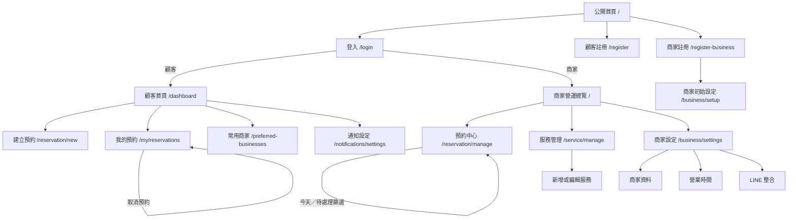

# Reservio 畫面與 API 關聯說明

> 本文件依目前前端路由、`frontend/src/api.ts` 與後端 Controller 整理。`{id}`、`{category}`、`{requestToken}` 代表動態路徑參數。

## 系統角色與入口

| 身分 | 首頁／主要入口 | 可進入的主要功能 |
| --- | --- | --- |
| 未登入訪客 | `/` 公開首頁 | 登入、顧客註冊、商家註冊、忘記密碼、LINE OAuth 登入 |
| 顧客 `ROLE_USER` | `/dashboard` | 建立預約、我的預約、常用商家、通知、通知設定、個人資料、LINE 帳號連結 |
| 商家 `ROLE_BUSINESS` | `/`（商家營運總覽） | 預約中心、服務管理、商家設定、LINE Messaging 整合、通知 |
| 尚未建立商家資料的商家 | `/business/setup` | 完成商家基本設定；完成前會被導向此頁 |

## 畫面關聯

## 共用機制

- `AuthContext` 在前端啟動與登入狀態刷新時呼叫 `GET /api/me`；用來決定角色、導向與權限。
- `SessionTimeoutManager` 定時呼叫 `GET /api/session`，並在閒置到期或登出時導回登入頁。
- 所有會改變資料的 `POST`、`PUT`、`DELETE` 請求，若瀏覽器沒有 `XSRF-TOKEN` Cookie，會先呼叫 `GET /api/csrf`，再以 `X-XSRF-TOKEN` Header 送出原請求。
- 共用導覽列會讀取未讀通知數與最新五筆通知：`GET /api/notifications/unread-count`、`GET /api/notifications?page=0&size=5`。
- 一般 API 回應格式為 `{ success, message, data }`；通知標示已讀端點回傳 `204 No Content`。

## 公開與帳號流程

| 路由／畫面 | 前往來源與下一步 | 直接呼叫 API |
| --- | --- | --- |
| `/` 公開首頁 | 前往登入或註冊；登入後依角色轉首頁 | 無 |
| `/login` 登入 | 成功後依角色到 `/dashboard` 或 `/`；可走 LINE OAuth | `POST /api/auth/login`；LINE OAuth 直接開啟 `GET /api/auth/line/user` 或 `GET /api/auth/line/business` |
| `/register` 顧客註冊 | 成功後登入／導向顧客流程 | `POST /api/auth/register` |
| `/register-business` 商家註冊 | 先載入類別；成功後至 `/business/setup` | `GET /api/businesses/category`、`POST /api/auth/register-business` |
| `/business/setup` 商家初始設定 | 僅未完成設定的商家可進入；成功後至商家首頁 | `GET /api/businesses/category`、`POST /api/businesses/setup` |
| `/forgot-password` | 寄送 OTP 後至驗證頁 | `POST /api/auth/forgot-password/request-otp` |
| `/forgot-password/verify` | 驗證 OTP；可重寄 OTP | `POST /api/auth/forgot-password/verify-otp`、`POST /api/auth/forgot-password/request-otp` |
| `/force-change-password` | 強制變更成功後依角色導向首頁 | `POST /api/auth/force-change-password` |
| 登出按鈕／逾時處理 | 清除登入狀態並回 `/login` | `POST /api/auth/logout` |

## 顧客畫面與 API

| 路由／畫面 | 畫面行為 | API |
| --- | --- | --- |
| `/dashboard` 顧客首頁 | 顯示近期預約與常用商家摘要 | `POST /api/reservations/customer/query?page=0&size=20&sortBy=reservationDate&sortDir=asc`、`GET /api/preferred-businesses` |
| `/reservation/new` 建立預約 | 選商家 → 選服務 → 選日期 → 選時段 → 確認建立 | 初始：`GET /api/preferred-businesses`，無常用商家時 `GET /api/businesses`；選商家：`GET /api/businesses/{id}/services`；選服務：`GET /api/reservations/disabled-dates?businessId={id}`；選日期：`GET /api/reservations/slots?date={date}&duration={duration}&businessId={id}`；送出：`POST /api/reservations` |
| `/my/reservations` 我的預約 | 分頁、日期／狀態／商家／服務篩選；取消預約 | `POST /api/reservations/customer/query?page={page}&size=10&sortBy={field}&sortDir={direction}`、`GET /api/reservations/customer/reserved-businesses`、依篩選商家呼叫 `GET /api/businesses/{id}/services`、取消時 `POST /api/reservations/{id}/cancel` |
| `/preferred-businesses` 常用商家 | 依類別挑選並儲存常用商家 | `GET /api/businesses/category`、`GET /api/businesses/{category}`、`GET /api/preferred-businesses`、`POST /api/preferred-businesses` |
| `/notifications` 通知中心 | 分頁載入、單筆已讀、全部已讀 | `GET /api/notifications?page={page}&size=20`、`POST /api/notifications/{id}/read`、`POST /api/notifications/read-all` |
| `/notifications/settings` 顧客通知設定 | 讀寫 Email 通知偏好與 Email 驗證 | `GET /api/notifications/preferences`、`PUT /api/notifications/preferences`、`POST /api/email-verification/request`、`POST /api/email-verification/verify` |
| `/profile` 個人資料 | 更新使用者名稱與 Email | `PUT /api/me/profile` |
| `/line/account-link?requestToken=...` | 查詢 LINE 帳號連結請求；未登入時先走顧客 LINE OAuth；確認連結 | `GET /api/line/account-links/{requestToken}`、`GET /api/auth/line/user`（瀏覽器導頁）、`POST /api/line/account-links/{requestToken}/confirm` |
| `/settings/line-accounts` | 列出已連結 LINE 帳號並解除連結 | `GET /api/line/account-links`、`DELETE /api/line/account-links/{lineCustomerId}` |

## 商家畫面與 API

| 路由／畫面 | 畫面行為 | API |
| --- | --- | --- |
| `/` 商家營運總覽 | 待處理預約、未讀通知、最新通知 | `POST /api/reservations/business/query`（待處理條件）、`GET /api/notifications/unread-count`、`GET /api/notifications?page=0&size=5` |
| `/reservation/manage` | 商家全部預約的清單／日曆檢視、篩選、分頁 | `POST /api/reservations/business/query?page={page}&size={size}&sortBy={field}&sortDir={direction}`、服務篩選選項為 `GET /api/businesses/{id}/services/active` |
| `/reservation/today/manage` | 預約中心的「今天」預設篩選 | 同 `/reservation/manage` |
| `/reservation/pending/manage` | 預約中心的「待處理」預設篩選 | 同 `/reservation/manage` |
| 預約中心詳情／操作 | 確認預約、取消、核准／拒絕取消申請；操作後重新查詢 | `POST /api/reservations/{id}/status`，body 的 `action` 為 `confirm`、`cancel`、`approveCancel` 或 `rejectCancel` |
| `/service/manage` | 載入服務清單，啟用、停用或刪除服務 | `GET /api/businesses/{businessId}/services`、`POST /api/businesses/services/{id}/on`、`POST /api/businesses/services/{id}/off`、`POST /api/businesses/services/{id}/delete` |
| `/service/new` | 新增服務，完成後回服務管理 | `POST /api/businesses/services` |
| `/service/{id}/edit` | 先讀服務清單定位服務，儲存修改後重新讀取確認 | `GET /api/businesses/{businessId}/services`、`POST /api/businesses/services/{id}/modify` |
| `/business/settings` 商家設定總覽 | 彙整營業時間、服務、通知與 LINE 狀態 | `GET /api/businesses/slot/default`、`GET /api/businesses/{id}/services`、`GET /api/notifications/preferences`、`GET /api/integrations/line/settings`、`GET /api/integrations/line/status` |
| `/business/settings/profile` | 載入類別並更新商家名稱、類別、電話、地址 | `GET /api/businesses/category`、`POST /api/businesses/info/update` |
| `/business/settings/booking` | 讀取、更新預約間隔；更新前後都重讀預設時段 | `GET /api/businesses/slot/default`、`POST /api/businesses/slot/default` |
| `/business/settings/hours` | 設定每週營業時間、查詢／儲存／刪除指定日期例外 | `GET /api/businesses/slot/default`、`POST /api/businesses/slot/default`、`GET /api/businesses/slot/adjusted`、`POST /api/businesses/slot/date`、`POST /api/businesses/slot/date/adjust`、`POST /api/businesses/slot/date/delete` |
| `/business/settings/notifications` | 商家帳號的 Email 通知偏好與 Email 驗證 | `GET /api/notifications/preferences`、`PUT /api/notifications/preferences`、`POST /api/email-verification/request`、`POST /api/email-verification/verify` |
| `/business/settings/integrations/line` | 讀取／儲存 LINE Messaging 設定、測試連線、建立 Rich Menu、輪替 Webhook Key、停用整合 | `GET`／`PUT /api/integrations/line/settings`、`GET /api/integrations/line/status`、`POST /api/integrations/line/test-connection`、`POST /api/integrations/line/rich-menu`、`POST /api/integrations/line/settings/rotate-webhook-key`、`POST /api/integrations/line/settings/disable` |
| `/business/settings/account` | 顯示目前帳號資料與可用設定入口；個人資料連至 `/profile` | 不直接呼叫 API；帳號資料來自共用 `GET /api/me` |
| `/business/info`、`/business/line-integration` | 舊路徑相容入口，分別導向商家資料與 LINE 整合頁 | 與目標畫面相同 |

## 後端 API 清單與前端使用狀態

| 方法 | Endpoint | 前端使用位置／用途 |
| --- | --- | --- |
| GET | `/api/csrf` | 所有資料異動請求的隱式 CSRF 前置請求 |
| GET | `/api/session` | SessionTimeoutManager |
| GET | `/api/me` | AuthContext、閒置恢復時的登入狀態確認 |
| PUT | `/api/me/profile` | 顧客個人資料 |
| GET | `/api/dashboard` | 目前 `api.ts` 有封裝，現行畫面未使用 |
| POST | `/api/auth/register` | 顧客註冊 |
| POST | `/api/auth/register-business` | 商家註冊 |
| POST | `/api/auth/login` | 帳密登入 |
| POST | `/api/auth/logout` | 登出 |
| POST | `/api/auth/forgot-password/request-otp` | 忘記密碼／重寄 OTP |
| POST | `/api/auth/forgot-password/verify-otp` | 驗證重設密碼 OTP |
| POST | `/api/auth/force-change-password` | 強制密碼變更 |
| GET | `/api/auth/line/user` | 顧客 LINE OAuth 導頁 |
| GET | `/api/auth/line/business` | 商家 LINE OAuth 導頁 |
| POST | `/api/email-verification/request` | Email 驗證碼寄送 |
| POST | `/api/email-verification/verify` | Email 驗證 |
| GET | `/api/notifications` | 導覽列、通知中心、商家總覽 |
| GET | `/api/notifications/unread-count` | 導覽列、商家總覽 |
| POST | `/api/notifications/{id}/read` | 導覽列、通知中心 |
| POST | `/api/notifications/read-all` | 導覽列、通知中心 |
| GET／PUT | `/api/notifications/preferences` | 顧客／商家通知設定、商家設定總覽 |
| GET | `/api/businesses` | 建立預約（常用商家為空時） |
| GET | `/api/businesses/category` | 商家註冊、初始設定、常用商家、商家資料 |
| GET | `/api/businesses/{category}` | 常用商家依類別篩選 |
| POST | `/api/businesses/setup` | 商家初始設定 |
| GET | `/api/businesses/{businessId}/services` | 建立預約、我的預約篩選、服務管理、服務編輯、設定總覽 |
| GET | `/api/businesses/{businessId}/services/active` | 商家預約中心服務篩選 |
| POST | `/api/businesses/services` | 新增服務 |
| POST | `/api/businesses/services/{id}/on` | 啟用服務 |
| POST | `/api/businesses/services/{id}/off` | 停用服務 |
| POST | `/api/businesses/services/{id}/delete` | 刪除服務 |
| POST | `/api/businesses/services/{id}/modify` | 修改服務 |
| POST | `/api/businesses/info/update` | 更新商家資料 |
| GET／POST | `/api/businesses/slot/default` | 預約間隔、每週營業時間、設定總覽 |
| GET | `/api/businesses/slot/adjusted` | 指定日期營業時間清單 |
| POST | `/api/businesses/slot/date` | 查詢指定日期的有效營業時間 |
| POST | `/api/businesses/slot/date/adjust` | 儲存指定日期營業時間 |
| POST | `/api/businesses/slot/date/delete` | 刪除指定日期例外 |
| GET／POST | `/api/preferred-businesses` | 常用商家、顧客首頁、建立預約 |
| POST | `/api/reservations/customer/query` | 顧客首頁、我的預約 |
| POST | `/api/reservations/business/query` | 商家總覽、商家預約中心 |
| POST | `/api/reservations` | 建立預約 |
| POST | `/api/reservations/{id}/cancel` | 顧客取消預約 |
| POST | `/api/reservations/{id}/status` | 商家更新預約狀態 |
| GET | `/api/reservations/slots` | 建立預約的可選時段 |
| GET | `/api/reservations/disabled-dates` | 建立預約的不可選日期 |
| GET | `/api/reservations/customer/reserved-businesses` | 我的預約篩選商家 |
| GET | `/api/reservations/today` | 後端提供；目前前端未使用 |
| GET | `/api/reservations/week` | 後端提供；目前前端未使用 |
| GET | `/api/reservations/month` | 後端提供；目前前端未使用 |
| GET／PUT | `/api/integrations/line/settings` | 商家 LINE 整合與設定總覽 |
| POST | `/api/integrations/line/settings/disable` | 停用 LINE 整合 |
| POST | `/api/integrations/line/settings/rotate-webhook-key` | 輪替 LINE Webhook Key |
| GET | `/api/integrations/line/status` | 商家 LINE 整合與設定總覽 |
| POST | `/api/integrations/line/test-connection` | 測試 LINE API 連線 |
| POST | `/api/integrations/line/rich-menu` | 建立／更新 LINE Rich Menu |
| GET | `/api/line/account-links/{requestToken}` | LINE 帳號連結狀態頁 |
| POST | `/api/line/account-links/{requestToken}/confirm` | 確認 LINE 帳號連結 |
| GET | `/api/line/account-links` | 已連結 LINE 帳號清單 |
| DELETE | `/api/line/account-links/{lineCustomerId}` | 解除 LINE 帳號連結 |
| POST | `/api/integrations/line/webhook/{webhookKey}` | LINE 平台呼叫的 Webhook；不是前端畫面發起 |

## 權限與導向規則

| 條件 | 行為 |
| --- | --- |
| 未登入進入受保護頁 | 導向 `/login?returnTo=...`，登入後回原目標頁 |
| 顧客嘗試進商家頁／商家嘗試進顧客頁 | 導向各自身分的登入後首頁 |
| 商家未完成初始設定 | 除 `/business/setup` 與 `/force-change-password` 外，一律導向 `/business/setup` |
| `mustChangePassword = true` | 除 `/force-change-password` 外，一律導向強制變更密碼頁 |
| 已登入者進登入／註冊頁 | 導向依角色決定的首頁；LINE OAuth callback 例外，以便處理 callback 狀態 |
